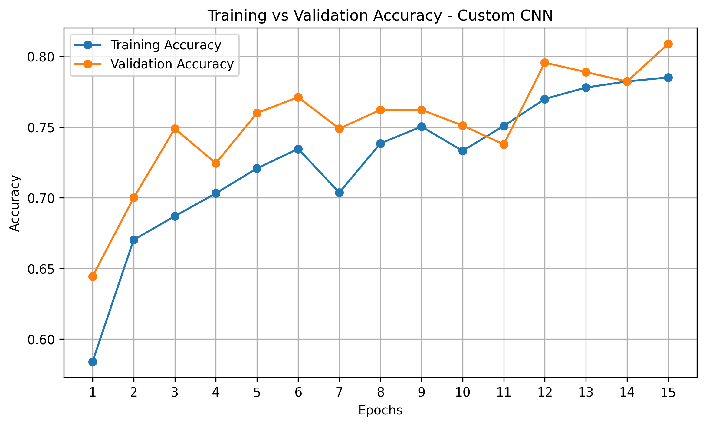
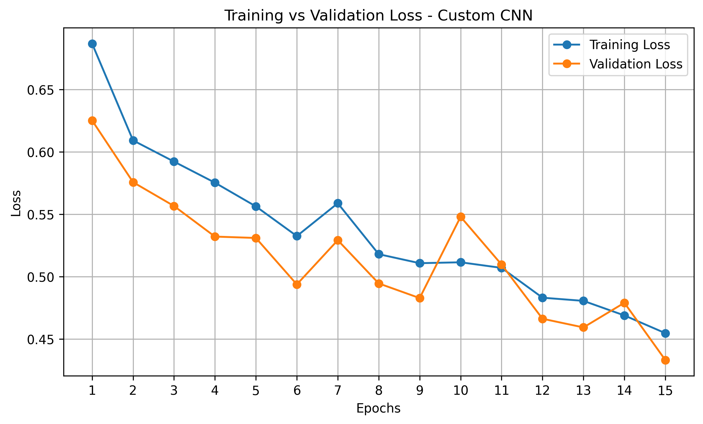
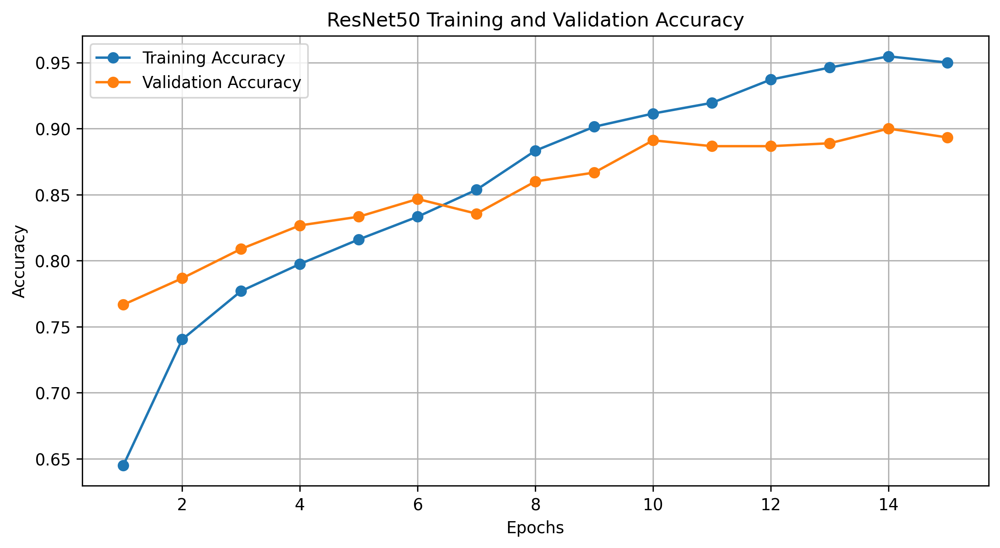
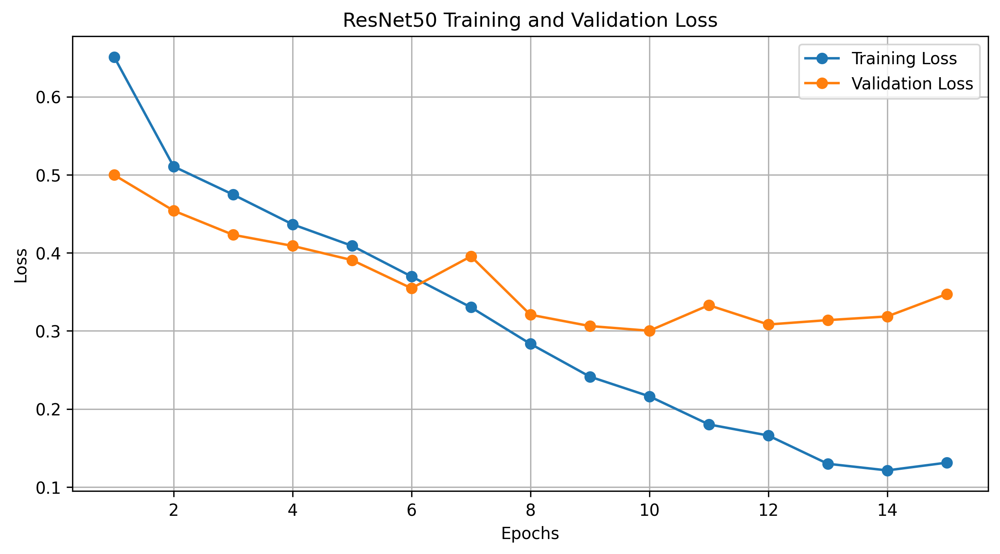
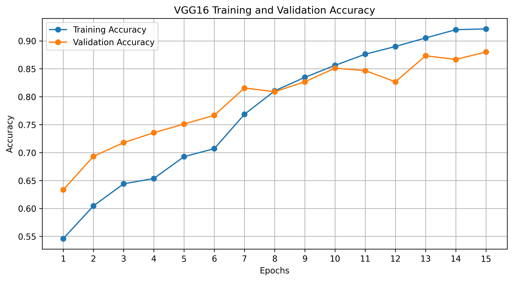
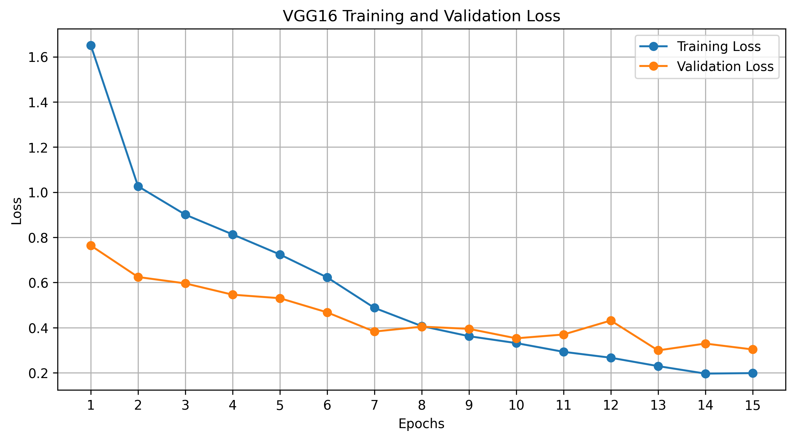

# Down Syndrome Detection from Facial Images Using Machine Learning

## Overview

This project explores the use of machine learning and deep learning techniques to classify facial images into two categories: Down Syndrome and Healthy.

Three deep learning models were implemented and evaluated: a Custom Convolutional Neural Network (CNN), ResNet50, and VGG16. Their performance was compared using accuracy, loss, precision, recall, F1-score, and confusion matrices.

The project demonstrates the application of computer vision and transfer learning for preliminary image-based screening research.

## Objectives

- Develop a custom CNN for facial image classification.
- Implement transfer learning using pre-trained ResNet50 and VGG16 architectures.
- Apply image preprocessing and data augmentation.
- Fine-tune selected layers of pre-trained models.
- Compare model performance using standard evaluation metrics.

## Dataset

The dataset contains 2,999 facial images collected from a Kaggle dataset repository.

| Category | Number of Images |
|---|---:|
| Down Syndrome | 1,500 |
| Healthy | 1,499 |
| **Total** | **2,999** |

### Image Specifications

- Image size: 224 × 224 pixels
- Format: RGB (3 channels)
- Pixel normalization: Model-specific preprocessing
- Classification type: Binary classification
- Learning type: Supervised learning

### Dataset Split

| Dataset | Images |
|---|---:|
| Training | 2,099 |
| Validation | 450 |
| Testing | 450 |
| **Total** | **2,999** |

The dataset is not included in this repository. It must be obtained separately with appropriate access and permissions.

## Methodology

1. **Dataset Loading:** Loaded and inspected facial images and their corresponding labels.
2. **Preprocessing:** Resized images to 224 × 224 pixels and applied model-specific normalization.
3. **Data Augmentation:** Applied transformations such as rotation, shifting, zooming, and horizontal flipping during training.
4. **Data Splitting:** Divided the dataset into training, validation, and testing sets.
5. **Model Development:** Implemented a custom CNN and transfer learning models.
6. **Fine-tuning:** Unfroze selected layers of the pre-trained models to adapt them to the dataset.
7. **Evaluation:** Evaluated the models using test accuracy, loss, confusion matrices, precision, recall, and F1-score.

## Models Implemented

### 1. Custom CNN

A convolutional neural network developed for this project. It uses convolutional layers, max pooling, a dense layer, and dropout for binary image classification.

### 2. ResNet50

A pre-trained deep learning architecture using residual connections. Transfer learning was applied by freezing the base model initially and fine-tuning selected layers.

### 3. VGG16

A pre-trained convolutional neural network using ImageNet weights. Global average pooling, dense layers, and dropout were added for classification, followed by fine-tuning of the final layers.

## Results and Model Comparison

The following table presents the performance of all three models on the test dataset.

| Model | Test Accuracy | Test Loss | Macro F1-score |
|---|---:|---:|---:|
| Custom CNN | 80.44% | 0.4518 | 80.41% |
| ResNet50 | 89.33% | 0.2401 | 89.30% |
| VGG16 | 89.33% | 0.2699 | 89.50% |

### Key Observations

- ResNet50 and VGG16 achieved the highest test accuracy of 89.33%.
- ResNet50 recorded the lowest test loss of 0.2401.
- VGG16 achieved the highest macro F1-score of 89.50%.
- Both pre-trained models performed better than the custom CNN in terms of test accuracy.

### Result Visualizations

The following graphs illustrate the training and validation performance of each model over 15 epochs.

#### 1. Custom CNN

**Training and Validation Accuracy**



**Training and Validation Loss**



#### 2. ResNet50

**Training and Validation Accuracy**



**Training and Validation Loss**



#### 3. VGG16

**Training and Validation Accuracy**



**Training and Validation Loss**



## Technologies Used

- Python
- TensorFlow and Keras
- NumPy
- Pandas
- Matplotlib
- Scikit-learn
- Seaborn
- Pillow
- Google Colab

## Repository Structure

```text
Down-Syndrome-Detection/
│
├── notebooks/
│   ├── cnn_down_syndrome_detection.ipynb
│   ├── resnet50_down_syndrome_detection.ipynb
│   └── vgg16_down_syndrome_detection.ipynb
│
├── results/
│   ├── cnn_accuracy_graph.png
│   ├── cnn_loss_graph.png
│   ├── resnet50_accuracy_graph.png
│   ├── resnet50_loss_graph.png
│   ├── vgg16_accuracy_graph.png
│   ├── vgg16_loss_graph.png
│   ├── cnn_results.csv
│   ├── resnet50_results.csv
│   ├── vgg16_results.csv
│   └── model_comparison.csv
│
├── README.md
├── requirements.txt
└── .gitignore
```

## How to Run

1. Clone or download this repository.
2. Install the required dependencies using:

   ```bash
   pip install -r requirements.txt
   ```

3. Obtain the dataset separately and organize it according to the paths expected in the notebooks.
4. Open the notebooks using Google Colab or Jupyter Notebook.
5. Update dataset paths as required.
6. Execute the notebook cells to train and evaluate the models.

## Author

**Ekansh Gupta**

## Disclaimer

This project is developed for academic and research purposes. The models are experimental image classifiers and have not been clinically validated. Their predictions should not be considered medical diagnoses or used as a substitute for professional medical evaluation.
